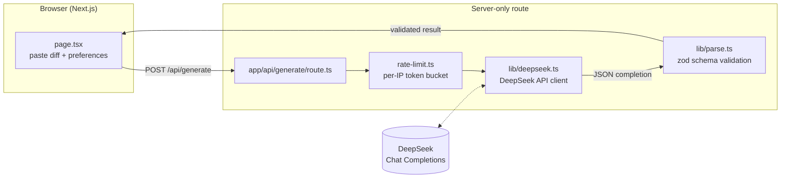

# PR Flash

A small developer tool that turns a git diff or change notes into ready-to-use PR artifacts: a title, a Conventional Commit message, a PR body, a one-line summary, and a concrete risk list.

The tool was built from a one-sentence request and is intended as a short, verifiable showcase of a TypeScript + DeepSeek API workflow.

## Stack

- Next.js 15 + React 19 + TypeScript
- DeepSeek Chat Completions API via a server-only Next.js route
- Vercel deployment support
- Safe Markdown rendering with `react-markdown` and no raw HTML rehydration

## Architecture



- `app/api/generate/route.ts` — validates input with zod, enforces per-IP rate limits, and returns typed errors (`400`/`429`/`500`/`502`).
- `lib/deepseek.ts` — the only place `DEEPSEEK_API_KEY` is read; server-only, never bundled into the client.
- `lib/parse.ts` — parses the model's JSON output and re-validates it against a zod schema before it is trusted.
- `lib/prompt.ts` — prompt hardening: treats input diffs/notes as inert untrusted text and instructs the model not to echo credentials.

## Features

- Paste a `git diff`, commit messages, or change notes
- Optional context such as acceptance criteria or related issue numbers
- Choose output language (`zh-CN` / `en-US`)
- Choose Conventional Commit or plain commit format
- Choose full output, commit-only, or PR-only mode
- Optional concrete risk list instead of generic "none" filler
- Copy buttons for title, commit message, PR body, summary, and risks
- Local demo responses when no API key is configured in development

## Run Locally

Prerequisites: Node.js 18.18 or newer.

```bash
npm install
cp .env.example .env.local
```

Set `DEEPSEEK_API_KEY` in `.env.local`, then:

```bash
npm run dev
```

Open http://localhost:3000.

Without an API key, development mode uses a clearly labeled local demo response so the UI can be tested end to end. Production defaults to a real model call and returns a configuration error if the key is missing.

## Model Configuration

The default model is `deepseek-flash`. If your DeepSeek account exposes the model as `deepseek-chat`, override it in the environment:

```bash
DEEPSEEK_MODEL=deepseek-chat
```

Optional variables:

| Variable | Default | Purpose |
| --- | --- | --- |
| `DEEPSEEK_API_KEY` | empty | Required for real model calls. Server-only. |
| `DEEPSEEK_BASE_URL` | `https://api.deepseek.com` | API base URL. |
| `DEEPSEEK_MODEL` | `deepseek-flash` | Chat model name. |
| `DEMO_MODE` | off in production, on in development | Forces a local sample response. |

## Deploy to Vercel

1. Push this repository to GitHub.
2. In Vercel, import the repository. Next.js is detected automatically.
3. Add production environment variables:
   - `DEEPSEEK_API_KEY`
   - `DEEPSEEK_BASE_URL=https://api.deepseek.com`
   - `DEEPSEEK_MODEL=deepseek-flash`
   - `DEMO_MODE=false`
4. Deploy and open the generated Vercel URL.

The API key is read only inside `app/api/generate/route.ts` and is never bundled into the client.

## Verification

```bash
npm run typecheck   # TypeScript type check
npm test            # unit tests (Vitest)
npm run build       # production build
```

Unit tests cover `lib/parse.ts` (JSON extraction and schema validation) and `lib/rate-limit.ts` (per-IP token bucket and window reset). CI (`.github/workflows/ci.yml`) runs typecheck, tests, and build on every push and pull request.

The repo also contains [SECURITY.md](./SECURITY.md) documenting the review that was performed before deployment readiness, including boundaries and residual risks.

## Resume Brief

Built **PR Flash**, a public-ready TypeScript/Next.js tool that uses the DeepSeek API to convert a diff into commit messages and PR descriptions. Responsibilities included environment setup, package management, serverless API implementation, prompt and input hardening, safe Markdown rendering, rate limiting, production build verification, security review, and deployment setup.